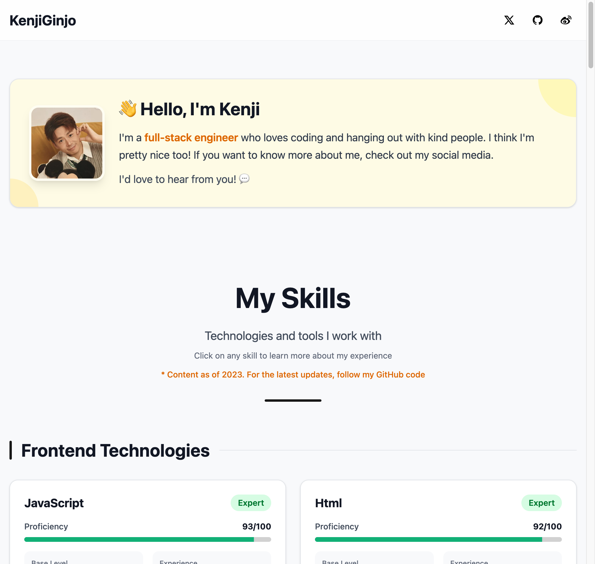

# DevFolio

A developer portfolio you can fork and make your own: profile, skill scores, and per-skill experience notes.

**[Live demo](https://kenjiginjo.com/)** · MIT License



## Stack

Vite · React 19 · TypeScript · Tailwind CSS 4 · shadcn/ui

## Quick start

```bash
git clone https://github.com/KenjiGinjo/DevFolio.git
cd DevFolio
pnpm install
pnpm dev
```

Open the URL Vite prints (usually `http://localhost:5173`).

| Command | What it does |
|---------|----------------|
| `pnpm dev` | Local preview |
| `pnpm build` | Production build to `dist/` |
| `pnpm preview` | Serve the production build locally |

## Make it yours

Change these two files first:

1. [`src/data/profile.ts`](src/data/profile.ts) — name, bio, photo, email, social links
2. [`src/data/skills.ts`](src/data/skills.ts) — skills, scores, and experience notes

Then:

- Replace `public/profile-photo.jpeg` with your photo
- Put social icons in `public/` and point to them from `profile.socials`
- Update `index.html` / `public/site.webmanifest` if you want a different tab title or PWA name

Skill score = `baseLevel + experience count`, capped at 100.

## Deploy

This is a static Vite app. After `pnpm build`, host the `dist/` folder anywhere:

- [Vercel](https://vercel.com/) — import the GitHub repo, framework preset Vite
- [Netlify](https://www.netlify.com/) / [Cloudflare Pages](https://pages.cloudflare.com/) — same idea
- Any Nginx/Caddy server — serve `dist/` as the site root

`pnpm deploy` uploads `dist/` to a personal server via SSH. It is optional. If you use it, copy `.env.example` to `.env` and fill in the values. Do not commit `.env`.

## License

[MIT](LICENSE) — use it, change it, ship it as your own portfolio.
